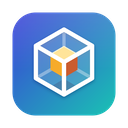
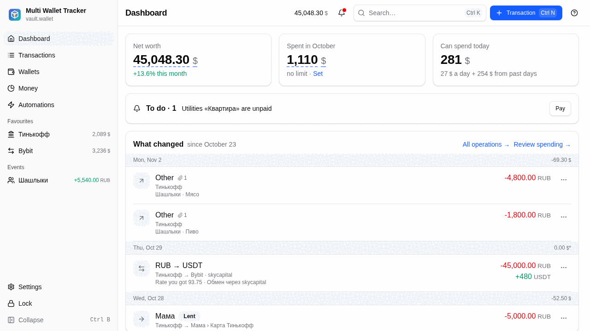
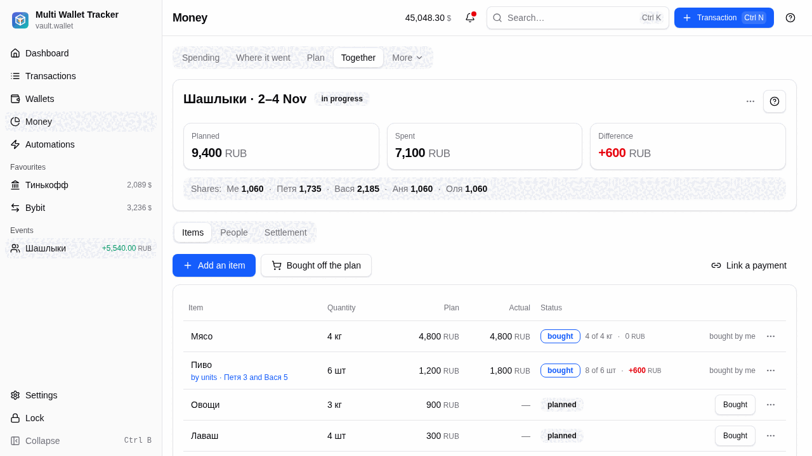
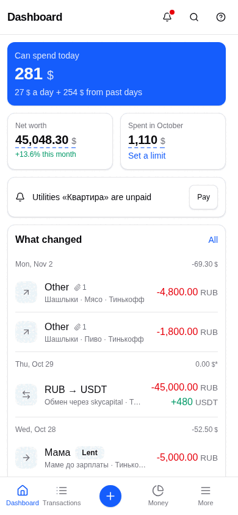

<div align="center">



# Multi Wallet Tracker

**Track crypto and fiat wallets, budgets and shared expenses. Local-first, encrypted, no account.**

[](https://github.com/Reckeck/mwt/actions/workflows/ci.yml)
[](https://github.com/Reckeck/mwt/releases/latest)
[](LICENSE)
[](#install)

[Download](#install) · [Docs](docs/user-guide.md) · [Report a bug](https://github.com/Reckeck/mwt/issues) · [Русский](README.ru.md)

<picture>
  <source media="(prefers-color-scheme: dark)" srcset="docs/images/dashboard-dark.png">
  
</picture>

</div>

## What it is

Multi Wallet Tracker (MWT) keeps all your wallets in one portfolio on your own device: cash, bank accounts,
exchanges and on-chain wallets. Your data lives in a single encrypted file (the vault). Nothing is uploaded
and there is no sign-up.

## Features

- **Wallets and sub-accounts** - cash, banks, crypto wallets, exchanges, property and loans, with envelopes that set money aside for a goal.
- **Portfolio** - holdings in many currencies and tokens, totals in your base currency, P&L, a price and FX cache that keeps working offline.
- **Transactions** - income, expenses, transfers and trades, with categories, contacts and a calendar.
- **Money overview** - where the money went, monthly plan, wealth and investments, a daily "can spend today" figure.
- **Automations** - recurring operations, reminders, price alerts and workflows you build from blocks.
- **Shared expenses** - plan an event, split the bill, see who owes whom ("Together").
- **Exchange import** - read-only Bybit API key (the client has no order endpoints) to prefill trades.
- **Device sync** - optional peer-to-peer sync over the local network, off by default ([docs/sync.md](docs/sync.md)).
- **Cross-platform** - Linux, Windows, macOS, Android; Russian and English UI, light and dark themes.

<table>
  <tr>
    <td width="68%">
      <picture>
        <source media="(prefers-color-scheme: dark)" srcset="docs/images/together-dark.png">
        
      </picture>
    </td>
    <td width="32%">
      <picture>
        <source media="(prefers-color-scheme: dark)" srcset="docs/images/phone-dark.png">
        
      </picture>
    </td>
  </tr>
</table>

The demo data in these screenshots is a mock vault with some Russian names.

## Privacy and security model

- One local vault file, encrypted at rest with XChaCha20-Poly1305; the key comes from your password through Argon2id (64 MiB, 3 iterations). A wrong password or a modified file never yields data.
- No telemetry, no analytics, no account. The app has no server of its own.
- Network use: public price and FX sources (CoinGecko, CoinCap, Binance, open.er-api.com, Frankfurter), public block explorers for transaction hints, and Bybit if you add a key. Requests carry asset identifiers, dates and, for explorer hints, the transaction hash you typed; never your balances or password. Local-network sync uses an encrypted channel and stays off until you enable it.
- There is no password recovery. If you lose the password, the data is gone. Back up the vault file.
- Details and known limits: [docs/security.md](docs/security.md). Where the vault file lives on each OS: [docs/storage-platforms.md](docs/storage-platforms.md).

## Install

| Platform | Download |
|---|---|
| Windows | [NSIS installer or MSI](https://github.com/Reckeck/mwt/releases/latest) |
| macOS | [.dmg](https://github.com/Reckeck/mwt/releases/latest), universal (Apple silicon and Intel) |
| Linux | [AppImage, .deb, .rpm](https://github.com/Reckeck/mwt/releases/latest), Flatpak bundle, Arch: `yay -S multi-wallet-tracker-bin` |
| Android 7.0+ | [APK](https://github.com/Reckeck/mwt/releases/latest) (sideload), signed with the project key |

- Windows installers and the macOS build are **not code-signed**. Windows SmartScreen and macOS Gatekeeper will warn on first launch; on macOS use right-click, Open.
- Two channels install side by side: **release** builds (`X.Y.Z`, from `main`) and **Dev** pre-releases (`X.Y.Z-N`, from `development`). The Dev app has its own name, identifier and vault location.

## Build from source

Requirements: [mise](https://mise.jdx.dev) (installs Node, pnpm and Rust) and the [Tauri v2 prerequisites](https://v2.tauri.app/start/prerequisites/) for your OS.

```bash
git clone https://github.com/Reckeck/mwt && cd mwt
mise install
mise run setup        # pnpm install + cargo fetch
mise run dev          # Tauri dev; `pnpm dev` runs the UI on a mock backend (password: secret)
mise run check        # the full gate: lint, types, tests, clippy, platforms
```

Architecture and packaging: [docs/architecture.md](docs/architecture.md), [docs/ci.md](docs/ci.md).

## Contributing

Issues and pull requests are welcome. Branches, Conventional Commits and the checks are in
[CONTRIBUTING.md](CONTRIBUTING.md). Translations live in `src/shared/config/i18n/locales/{ru,en}.json`.

## Security

Do not open public issues for vulnerabilities. Use GitHub private vulnerability reporting
(Security tab, Report a vulnerability). See [SECURITY.md](SECURITY.md).

## License

[MIT](LICENSE).

## Acknowledgements

[Tauri](https://tauri.app), [Vue](https://vuejs.org), [TanStack Query](https://tanstack.com/query),
[Apache ECharts](https://echarts.apache.org), [reka-ui](https://reka-ui.com) and
[shadcn-vue](https://www.shadcn-vue.com), [RustCrypto](https://github.com/RustCrypto) (argon2, chacha20poly1305),
and the free data providers CoinGecko, CoinCap, Binance, open.er-api.com and Frankfurter.
