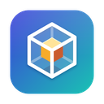
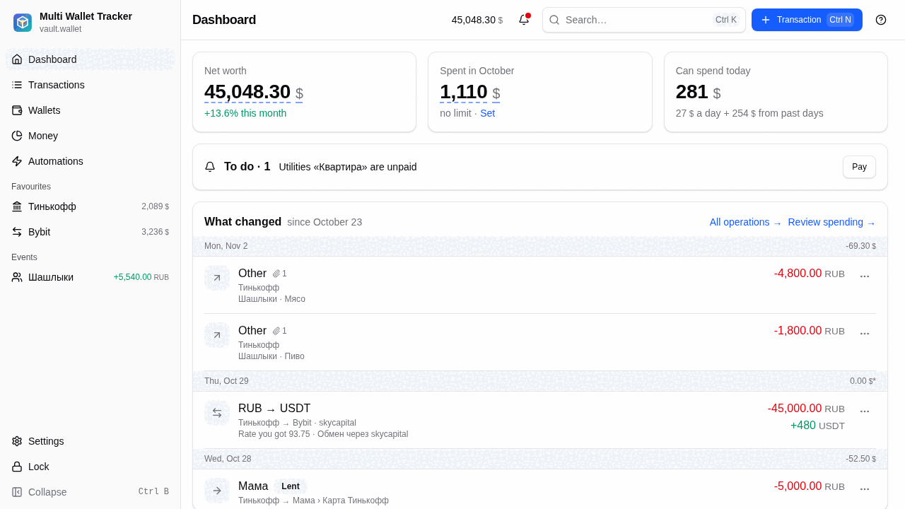
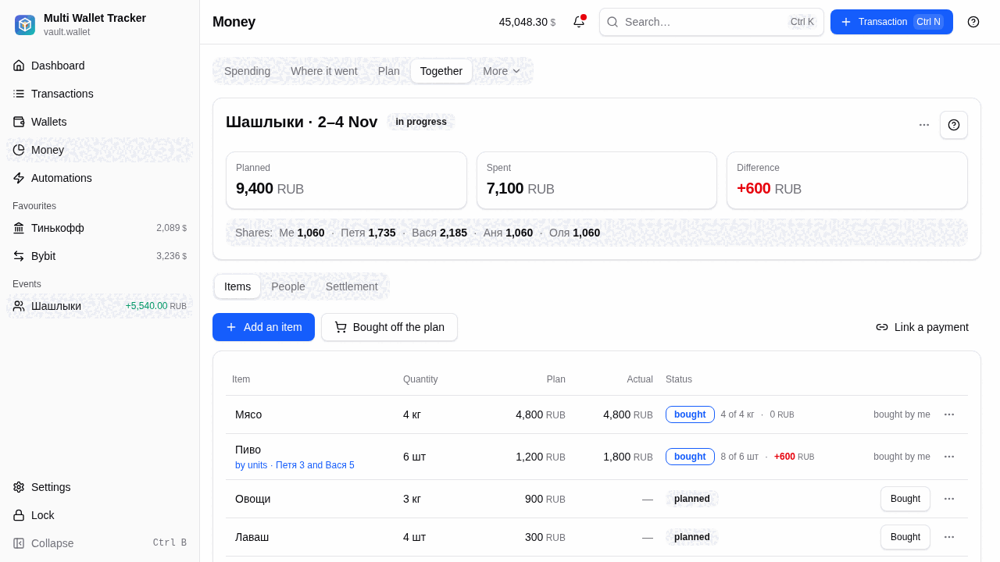
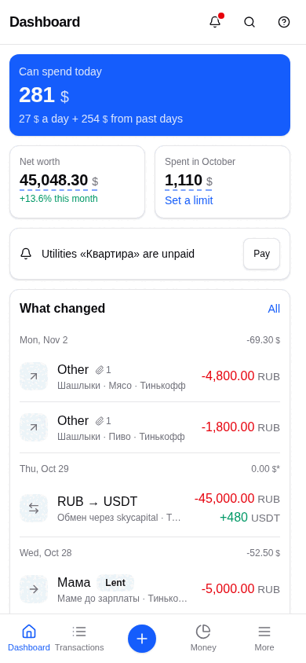

<div align="center">



# Multi Wallet Tracker

**Учёт крипто- и обычных кошельков, бюджета и общих трат. Всё локально, под шифрованием, без аккаунта.**

[](https://github.com/Reckeck/mwt/actions/workflows/ci.yml)
[](https://github.com/Reckeck/mwt/releases/latest)
[](LICENSE)
[](#установка)

[Скачать](#установка) · [Документация](docs/user-guide.md) · [Сообщить об ошибке](https://github.com/Reckeck/mwt/issues) · [English](README.md)

<picture>
  <source media="(prefers-color-scheme: dark)" srcset="docs/images/dashboard-dark.png">
  
</picture>

</div>

## Что это

Multi Wallet Tracker (MWT) собирает все ваши кошельки в один портфель на вашем устройстве: наличные, банковские
счета, биржи и ончейн-кошельки. Данные лежат в одном зашифрованном файле (vault). Ничего не выгружается в
облако, регистрации нет.

## Возможности

- **Кошельки и субсчета** - наличные, банки, крипто-кошельки, биржи, имущество и кредиты; конверты откладывают деньги на цель.
- **Портфель** - активы в разных валютах и токенах, итоги в базовой валюте, P&L, кэш цен и курсов, который работает офлайн.
- **Операции** - доходы, расходы, переводы и сделки, с категориями, контактами и календарём.
- **Обзор денег** - куда ушли деньги, план на месяц, капитал и инвестиции, ежедневная цифра «можно потратить сегодня».
- **Автоматизации** - повторяющиеся операции, напоминания, ценовые алерты и сценарии из блоков.
- **Общие траты** - спланировать событие, поделить счёт, увидеть, кто кому должен («Вместе»).
- **Импорт с биржи** - ключ Bybit только для чтения (в клиенте нет эндпоинтов ордеров), чтобы заполнять сделки.
- **Синхронизация устройств** - необязательная, напрямую по локальной сети, по умолчанию выключена ([docs/sync.md](docs/sync.md)).
- **Много платформ** - Linux, Windows, macOS, Android; интерфейс на русском и английском, светлая и тёмная темы.

<table>
  <tr>
    <td width="68%">
      <picture>
        <source media="(prefers-color-scheme: dark)" srcset="docs/images/together-dark.png">
        
      </picture>
    </td>
    <td width="32%">
      <picture>
        <source media="(prefers-color-scheme: dark)" srcset="docs/images/phone-dark.png">
        
      </picture>
    </td>
  </tr>
</table>

Снимки сделаны на демо-хранилище; интерфейс на них английский, часть демо-названий русская.

## Приватность и безопасность

- Один локальный файл vault, зашифрован XChaCha20-Poly1305; ключ получается из пароля через Argon2id (64 МиБ, 3 прохода). Неверный пароль или изменённый файл данных не дают.
- Нет телеметрии, нет аналитики, нет аккаунта. У приложения нет собственного сервера.
- Сеть: публичные источники цен и курсов (CoinGecko, CoinCap, Binance, open.er-api.com, Frankfurter), публичные обозреватели блоков для подсказок по транзакциям и Bybit, если вы добавили ключ. В запросах - идентификаторы активов, даты и, для подсказок обозревателя, введённый вами хеш транзакции; ни балансов, ни пароля. Синхронизация по локальной сети идёт по зашифрованному каналу и выключена, пока вы её не включите.
- Восстановления пароля нет. Забыли пароль - данные потеряны. Делайте копии файла vault.
- Подробности и известные ограничения: [docs/security.md](docs/security.md). Где лежит файл vault на каждой ОС: [docs/storage-platforms.md](docs/storage-platforms.md).

## Установка

| Платформа | Загрузка |
|---|---|
| Windows | [установщик NSIS или MSI](https://github.com/Reckeck/mwt/releases/latest) |
| macOS | [.dmg](https://github.com/Reckeck/mwt/releases/latest), универсальный (Apple silicon и Intel) |
| Linux | [AppImage, .deb, .rpm](https://github.com/Reckeck/mwt/releases/latest), бандл Flatpak, Arch: `yay -S multi-wallet-tracker-bin` |
| Android 7.0+ | [APK](https://github.com/Reckeck/mwt/releases/latest) (вручную), подписан ключом проекта |

- Установщики Windows и сборка macOS **не подписаны**. SmartScreen и Gatekeeper предупредят при первом запуске; на macOS откройте через правый клик, «Открыть».
- Два канала ставятся рядом: **релиз** (`X.Y.Z`, из `main`) и пре-релизы **Dev** (`X.Y.Z-N`, из `development`). У Dev-приложения своё имя, идентификатор и место vault.

## Сборка из исходников

Нужны [mise](https://mise.jdx.dev) (ставит Node, pnpm и Rust) и [зависимости Tauri v2](https://v2.tauri.app/start/prerequisites/) для вашей ОС.

```bash
git clone https://github.com/Reckeck/mwt && cd mwt
mise install
mise run setup        # pnpm install + cargo fetch
mise run dev          # Tauri dev; `pnpm dev` запускает UI на мок-бэкенде (пароль: secret)
mise run check        # полный гейт: линт, типы, тесты, clippy, платформы
```

Архитектура и упаковка: [docs/architecture.md](docs/architecture.md), [docs/ci.md](docs/ci.md).

## Участие в разработке

Issues и pull request приветствуются. Ветки, Conventional Commits и проверки - в
[CONTRIBUTING.md](CONTRIBUTING.md). Переводы - в `src/shared/config/i18n/locales/{ru,en}.json`.

## Безопасность

Не создавайте публичные issue об уязвимостях. Используйте приватное сообщение об уязвимости GitHub
(вкладка Security, Report a vulnerability). См. [SECURITY.md](SECURITY.md).

## Лицензия

[MIT](LICENSE).

## Благодарности

[Tauri](https://tauri.app), [Vue](https://vuejs.org), [TanStack Query](https://tanstack.com/query),
[Apache ECharts](https://echarts.apache.org), [reka-ui](https://reka-ui.com) и
[shadcn-vue](https://www.shadcn-vue.com), [RustCrypto](https://github.com/RustCrypto) (argon2, chacha20poly1305),
а также бесплатные источники данных CoinGecko, CoinCap, Binance, open.er-api.com и Frankfurter.
