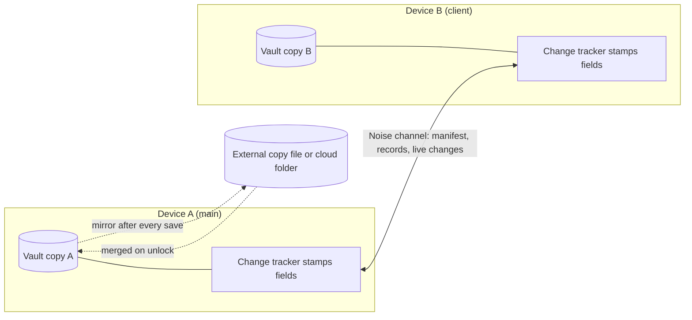

# Device sync over the local network

Two or more devices that have the same vault open on one network find each
other and exchange changes directly, encrypted, with no cloud and no server.
The mode is off by default (Settings, Sync). This page is the overview and the
table of contents; each topic has its own chapter in `docs/sync/`.

Decisions: 2026-10-17 (plan `bubbly-jumping-hare`). The repair stages A, A2,
1a, B1, B2 and the transfer fix (2026-11-01 .. 2026-11-03) are described in
the chapters below; where a stage specification and the code differ, the code
is what the chapters document.

## The model in one screen

- **One vault, many copies.** Every device holds a full, encrypted copy of the
  vault. There is no master copy. The vault password is never sent: each device
  has its own password for its own file.
- **Stamps.** A save does not know about sync. After every save, the change
  tracker compares each record with the previous save and puts a hybrid-clock
  stamp (`wall time, counter, device tag`) on every changed field. A deleted
  record leaves a tombstone.
- **Merge per field.** For every field the larger stamp wins. Edits of
  different fields of one record both survive. A deletion beats earlier edits.
  The result is the same on both sides, whichever computes it.
- **A star, not a mesh.** One device of the group is the main device; the
  others connect to it. Roles decide who is dialed, not whose data wins.
- **The user stays in control.** Pairing needs a six-digit code confirmed on
  both screens. A list of incoming changes can be shown before it is applied.
  Every applied batch can be undone. A copy of the vault is saved before the
  first batch of each session.
- **One job, one run.** A scheduled workflow, a question and a reminder can be
  met by more than one device. A deterministic run key makes the second run a
  no-op, or merges its result away after the next exchange.

## Chapters

| Chapter | What it covers | For whom |
|---|---|---|
| [Devices and roles](sync/devices-and-roles.md) | device identity, Off / Searching / Main / Client, who runs scheduled jobs, presence and notifications | developer, user |
| [Pairing and trust](sync/pairing.md) | discovery, the pairing code, trust and revoke stamps, forget and re-pair, pause on decline, cut-off notices | developer, user |
| [Exchange and merge](sync/exchange-and-merge.md) | session flow, stamps, per-field last-writer-wins, collection rules, tombstones, device-only settings | developer |
| [The change question, history and undo](sync/plan-question-and-undo.md) | the list of changes, timeout, held records, decline, history, undo | developer, user |
| [Duplicates and run keys](sync/dedupe-and-run-keys.md) | natural keys, dedupe with carry of later edits, run keys, group time zone, reminders, alerts | developer |
| [Vault transfer](sync/transfer.md) | sending a whole vault to a new device | developer, user |
| [The external copy](sync/external-copy.md) | the mirrored file, merge on unlock, conflicts | developer, user |
| [Compatibility between versions](sync/compatibility.md) | protocol and format versions, the additive-field policy, what an old peer still gets wrong | developer |
| [Troubleshooting](sync/troubleshooting.md) | symptom, cause, what to do | user |

Related documents: `docs/storage-platforms.md` (vault files, the mirror),
`docs/security.md` (threat model of the whole app), `docs/ipc.md` (commands
and events).

## Where the code is

| Part | Place |
|---|---|
| Change tracking, merge, plan, undo data (pure, no network) | `crates/core/src/sync/`: `stamp`, `state`, `registry`, `view`, `fields`, `track`, `merge`, `plan`, `manifest`, `journal`, `alias` |
| The encrypted channel, the pairing code, the vault proof, the clock check | `crates/core/src/sync/session.rs`, `protocol.rs` |
| Vault transfer protocol (SPAKE2, file check) | `crates/core/src/sync/transfer.rs` |
| Vault side: stamping on save, `sync_apply`, `sync_undo`, dedupe, backups, peers | `crates/core/src/service/peer_sync.rs` |
| Run keys, waits, schedule moments, marks | `crates/core/src/workflow/run_key.rs`, `crates/core/src/service/workflows.rs` |
| Reminder ids and sources | `crates/core/src/service/auto_reminders.rs` |
| Network: mDNS, TCP, roles, sessions | `crates/app/src/sync/`: `discovery`, `link`, `mod` (hub), `keystore`, `host`, `firewall`, `handover`, `transfer`, `pending` |
| Who runs background jobs | `crates/app/src/scheduler.rs`, `sync::runs_jobs` |
| The external copy | `crates/app/src/platform_fs/links.rs`, `crates/core/src/vault_io/mirror.rs` |
| Commands and events | `crates/app/src/commands/sync.rs`, `docs/ipc.md` |
| Interface | `src/features/vault-sync/`, `src/widgets/sync-settings/` |

## Glossary

| Term | Meaning |
|---|---|
| Stamp | `Stamp { wall_ms, counter, device }`: a hybrid logical clock value. It orders changes from different devices. |
| Tombstone | the stamp of a deletion, kept so the record does not come back from another device |
| Record | one item of a synced collection, addressed as `collection:key` |
| Manifest | the list `collection:key -> digest` that a device sends so the other can ask for what differs |
| Batch | everything one incoming list of records changed here, kept for undo |
| Trusted device | a device whose key was confirmed by a pairing code; stored in `SyncState.peers` |
| Revoked (forgotten) | a trusted entry with a `revoked` stamp; the key is refused until a newer pairing |
| Pause | local decision "do not exchange with this device" (`SyncState.paused`), set by declining a list of changes |
| Cut-off (`cut_by`) | what another device told this one: it paused or forgot this device (`SyncState.cut_by`) |
| Main / client | roles of the star; the main device is dialed by the others |
| `runs_jobs` | true when this device runs scheduled jobs: everywhere except a client |
| Run key | a name for one occasion a job runs, identical on every device |
| Natural key | what makes two generated records "the same thing" (import execution id, automation plus planned moment, run key) |
| Group zone | `Settings.schedule_timezone`: the time zone in which schedule moments are computed on all devices |
| External copy | the sealed vault file mirrored to a user-chosen location |

## Limitations

- Sync runs while the vault is unlocked on both devices. On Android a
  minimized app keeps it alive in a foreground service (`plugin-net`, type
  `connectedDevice`, a Wi-Fi lock; the notification permission is requested when
  sync is turned on). The notification shows the number of devices and the
  "Lock" and "Stop" buttons ("Stop" lasts until the app is opened again). After
  the chosen time in the background without a sync (5 to 60 minutes, 30 by
  default, or never) the vault locks itself. Battery-optimization exemption is
  not requested: in Doze the connection freezes and the next session transfers
  only what is missing.
- Clock skew is compensated by the hybrid clock: after two devices meet, new
  edits of the lagging device sort after the edits of the one that ran ahead.
  Edits made before the meeting are compared by their own stamps. Large skews
  are refused (see [Pairing and trust](sync/pairing.md)).
- Discovery is mDNS. On networks where multicast is forbidden (guest Wi-Fi with
  client isolation) devices do not see each other.
- BLE is a possible later transport on top of the same protocol. Whole-file
  sync through an external copy is a separate feature that meets this one at
  unlock (see [The external copy](sync/external-copy.md)).
