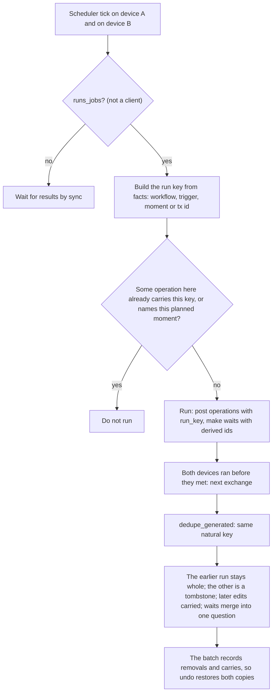

# Duplicates and run keys

Part of the sync documentation, see [the overview](../sync.md). Previous:
[The change question, history and undo](plan-question-and-undo.md). Next:
[Vault transfer](transfer.md).

## The problem

A job is one occasion on which something runs: a schedule moment, a new
operation a trigger reacts to, a wait that wakes, a reminder that is due, an
alert that fires. More than one device can meet the same occasion:

- a device that is not a client runs jobs, and Off, Searching and Main all
  qualify ([Devices and roles](devices-and-roles.md));
- two devices that were apart both ran the same moment before they met;
- a locked app and an unlocked one both noticed the same alert.

Without a mechanism, each run posts its own transaction, asks its own question or
creates its own reminder. The mechanism has three layers: **don't run twice
when you already know**, **merge away the second result when you learn of it
later**, and **carry the user's later edits across the merge**.

## Natural keys and the duplicate pass

After every `sync_apply`, `dedupe_generated` looks at what the vault generated
itself. Two records are "the same thing" when they share a **natural key**:

| Record | Natural key |
|---|---|
| Transaction from an import | `import:<exec_id>` |
| Transaction from an old automation | `auto:<automation_id>:<planned_at>` |
| Transaction from a workflow that dated itself by a schedule | `auto:<workflow_id>:<planned_at>`, so a copy made by an older build (no run key) meets a new one |
| Transaction from a workflow with a run key and no `planned_at` | `run:<run_key>` |
| Reminder | `<kind>/<entity id>` of its source, or its `source_key` if it has no source |

### Which copy stays

- The winner is the copy created first (by its creation stamp), then the smaller
  id, so both devices choose the same one.
- **A workflow run can book several operations for one moment** (salary and tax).
  The earliest operation picks the winning run; everything of that run stays, and
  so does everything made on the winner's device (a separate run of its own).
  Only an operation of another run made on another device goes.
- **An operation without a stamp is never deleted**: nobody can tell which copy
  is later. Imports and automations without stamps are left alone too.
- A device with the older rule (the winner by creation stamp only) may drop an
  edited copy; see [Compatibility](compatibility.md).

### Carry of later edits

When a copy goes, the fields that were edited **later** than the kept copy's
fields are moved into the kept copy, each with its own stamp ("carry"):

- It applies to plain copies of one operation (imports, automations) and to
  reminders. Operations of different workflow runs are different bookings and do
  not take each other's edits.
- The key fields never move, and a field with an equal value has nothing to
  carry.
- The removal is an ordinary deletion (a tombstone each) and the carried fields
  are written into the same batch, so **undoing the batch restores both
  copies**. Everything is announced to a live session, and the tracker is rebased
  so none of it is stamped again.
- The result is deterministic: two new-version devices end with the same record
  after at most two exchanges, and a pair of old and new versions converges to
  one record without a delete and recreate loop.

## Run keys

A run key is a plain string built in one function (`workflow::run_key::RunKey`)
from facts only, so every device builds the same string for the same occasion.

| Occasion | Key | Notes |
|---|---|---|
| Schedule moment | `wf:<workflow_id>:<trigger_id>:<moment>` | `<moment>` is the planned instant as UTC RFC3339 (for example `2026-11-01T09:00:00Z`), computed in the group zone |
| Operation trigger | `tx:<workflow_id>:<trigger_id>:<tx_id>` | a workflow never reacts to an operation it made itself |
| Wait wake-up | `wait:<wait_id>:<port>` | `<port>` is `out` for a timer; `true` or `false` for a question, and an unanswered question counts as `false` |

Every operation a run posts records the key in an additive `TxOrigin::Workflow
{ run_key }` field. An old operation (before keys) has `run_key: None` and goes
by `planned_at`.

### Before running

`fire` and `fire_all` skip a firing whose key is already booked here
(`already_run`): some operation already carries it. For a schedule moment a
legacy check also applies: an operation without a key that names the same
`planned_at` blocks the run (`legacy_moment_booked`).

### After a sync

`dedupe_generated` merges operations with the same natural key (above). Two
devices that both ran a moment before they met end with one booking.

### Waits and questions

- A wait made by a run gets a deterministic id: `<run key>#<node id>`. Two devices
  that start the same run produce the same wait record, and sync merges them into
  one question. The user sees one "pay yourself" question.
- A resumed wait leaves a tombstone. `wait_is_new` refuses to add a wait that is
  already present or was already resumed (it has a tombstone), so a late copy of
  an answered question does not come back.
- Answering a question whose run key already has a booked result does nothing
  but remove the question (the error is "already answered"). One answer gives one
  set of transfers.

### The group zone

Schedule moments are computed in one time zone for all devices, not in each
device's own zone, otherwise the keys would differ. It is stored as the synced
setting `Settings.schedule_timezone` (additive, `serde(default)`). When it is
unset, the first device that saves or runs a schedule writes its current zone
(`schedule_zone`); the setting then syncs like any other settings field. There is
no screen for it. Until the first value reaches the other devices, a device that
has none of its own would compute with its device zone; if two devices write one
at the same moment, the settings merge (later stamp wins) picks one.

### Marks never go back

`workflow_state.marks["schedule:<trigger>"]` is the last moment fired.

- Marks merge per entry, each by its own stamp, so a mark of another trigger is
  never lost ([Exchange and merge](exchange-and-merge.md)).
- A schedule mark never stays below a moment whose run key is booked
  (`keep_schedule_marks`). `sync_undo` calls it, so an undone operation does not
  make the trigger fire again. A local undo (deleting the posted operation)
  never touches the mark, so the moment does not run again either
  (`undoing_an_operation_here_does_not_move_a_schedule_mark_back`).
- The transaction cursor is device-local; run keys make a different cursor on two
  devices harmless.

## Reminders

Automatic reminders (loan payment, rent, utilities, deposit end, goals, and so
on) are generated from data.

- A reminder's source is `(kind, entity id)`, for example a loan id. Its **id**
  is derived from it: `auto-<kind>-<entity id>`, the same on every device, so two
  devices that place it meet in one record.
- Its `source_key` is `<kind>/<entity id>/<schedule>`: the source identity is in
  front, so two loans due on the same day at the same time never share a key. The
  older key was the schedule alone.
- Reminders made before this have random ids. The duplicate pass groups them with
  the new ones by their source (or by `source_key` when there is no source).
- The earliest copy stays. The other copy's later-edited `done`, `muted`,
  `snoozed_until`, `user_edited` and time fields are carried into it, each by its
  own stamp, and the removal is an ordinary deletion, so a deleted copy is never
  resurrected.

## Alerts fired while the vault was locked

A locked app checks price alerts against fresh prices from a snapshot and keeps
what fired. On the next unlock `merge_locked` applies it, but:

- only on a device that runs jobs; a client drops the findings;
- each firing carries the alert's condition, price, currency and active flag as
  the locked app saw them (`AlertBase`). `apply_locked_deliveries_seen` marks the
  alert triggered only if the alert is unchanged since: a newer threshold that
  arrived by sync wins, and the alert is not switched off. The notice that was
  shown is still logged.
- A firing without a recorded base (written by an older build) applies as before.

Next: [Vault transfer](transfer.md).
