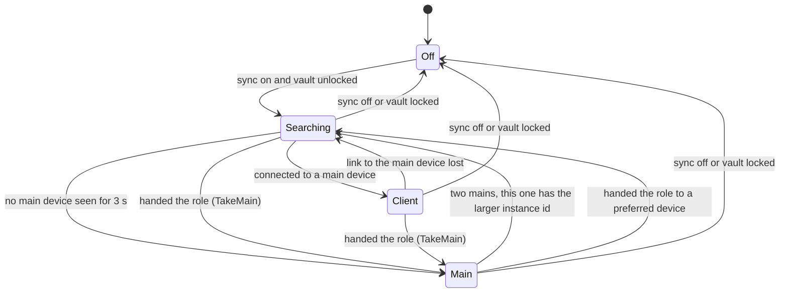
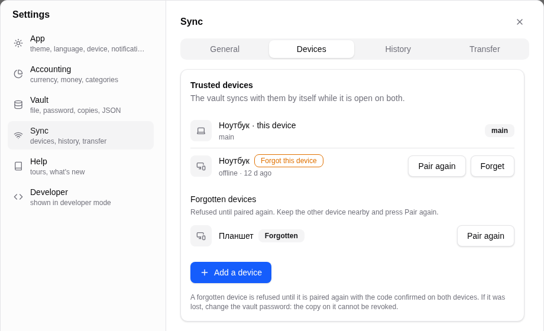
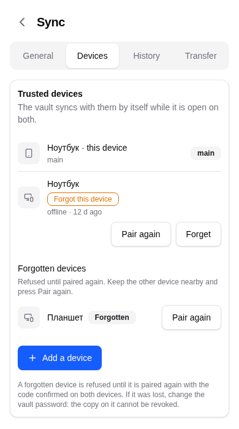

# Devices and roles

Part of the sync documentation, see [the overview](../sync.md). Next:
[Pairing and trust](pairing.md).

## Device identity

A device has three identities, used for different things.

| Identity | What it is | Where it lives | What it is used for |
|---|---|---|---|
| Device id | a random UUID made once per installation (`AppSettings.ensure_device_id`) | app settings, outside the vault | trusted-device list, pauses, cut-offs, batch history |
| Device name | a friendly name such as "Juicy Orange" (adjective and fruit in the app language, editable in Settings, Sync) | app settings | shown while pairing, in the device list, in notices |
| Device key | a static X25519 key for the Noise channel | Android: wrapped by a hardware Android Keystore key. Desktop: the OS password store (`keyring`). Neither available: memory only | recognising a trusted device in the handshake |

Stamps carry only a short device tag: the first eight alphanumeric characters
of the device id (`stamp::device_tag`). The tag is the last tie-breaker when
two stamps have the same time and counter.

If the device key lives only in memory (no system password store), the key
changes after a restart and the devices have to pair again. The settings screen
says so (`sync.key.memory`).

The vault password is never part of sync. Each device opens its own file with
its own password; after a password change the app reminds the user that the
other devices still use the old one.

## Roles

`SyncRole` has four values.

| Role | Meaning |
|---|---|
| Off | Sync is turned off, or the vault is locked |
| Searching | Sync is on and the device is looking for the main device of its group |
| Main | The other devices connect to this one |
| Client | Connected to the main device |



### How the main device is chosen (the star)

- Discovery announces `_mwt-sync._tcp` over mDNS. The TXT record carries only a
  daily tag `HMAC(vault.id, "mwt-disc" + day)[..8]`, the main-device flag and a
  version. The device name is not advertised. Outsiders see bytes that change
  every day.
- A device that sees no main device for 3 seconds (`ELECTION_WAIT`) becomes
  main. The others connect to it.
- With two main devices, the one with the larger random mDNS instance id steps
  down (it returns to Searching and connects to the other).
- When the main device leaves, each client waits its turn before it tries to
  take over: about `1 s + rank * 2 s` (the rank was given by the main device,
  capped at 30), plus a backoff of 5 s, 10 s, 20 s up to 5 minutes when sessions
  keep failing. The first to finish waiting becomes main; the others connect to
  it.
- "Make this device the main one" (`prefer_main`) hands the role to a device
  after its first exchange is through, never in the middle of a transfer. The
  current main sends `TakeMain` over the live link and steps down only after the
  client answers with its `Peers` list (sent when the client reaches live mode),
  because a client in the middle of a question only queues the hand-over. A
  `TakeMain` heard or ordered before `live` starts is queued, not dropped.
- **Port and the return call.** Sync listens on TCP 53318 (a random port if
  that one is busy). A client that cannot connect to the main device does not
  make itself main; it waits. After 6 seconds the main device calls back every
  device of the group that it sees in mDNS but has no link with. After three
  failed attempts in a row the main device is considered gone. If connections
  arrive from both sides at once, the one the client dialed stays.
- **Firewall.** A client that could not connect reports `unreached` in its
  hello, and the main device shows "A firewall blocks incoming connections".
  The "Open the port" button adds a rule for the local subnet only: Linux
  through `pkexec` with ufw or firewalld, Windows through `netsh` and UAC
  (Private profile). Flatpak may not touch the host firewall and shows commands
  for a terminal. macOS asks by itself; Android has no firewall.
- **Diagnostics.** Settings, Sync shows the port, the address, how many devices
  with this vault are visible and the last error. After 30 seconds without
  neighbors it shows a hint about what to check.

## Who runs scheduled jobs

Background jobs are automations, workflows (schedule moments, operation
triggers, waits), Bybit import, price alerts, reminders, price and rate
refresh. The scheduler thread (`crates/app/src/scheduler.rs`) asks
`sync::runs_jobs` before running them:

```text
runs_jobs = sync is off  OR  role != Client
```

So **Off, Searching and Main all run jobs; only a Client does not.** Clients
receive the results through sync.

This differs from the older wording "only the main device runs jobs". The
Searching window (a few seconds after unlock, or while a client looks for a new
main device) is a time when a device does run jobs, and a device that has never
found a main device runs them too. That is why jobs carry run keys: if two
devices run the same moment, the second run is recognised and merged away (see
[Duplicates and run keys](dedupe-and-run-keys.md)). The in-app hint for "Make
this device the main one" ("runs automations, workflows, exchange imports and
reminders for everyone") describes the intent, not a lock.

Two further rules in the scheduler:

- Before running jobs, the scheduler merges what the app found while the vault
  was locked (notices shown from the locked snapshot, alerts that fired).
  `merge_locked` applies this only when `runs_jobs` is true. A client drops the
  locked findings: the main device owns alerts and the notification log, and a
  stale snapshot would only fight what comes by sync.
- A manual price refresh works on every device: price and rate caches are
  merged as unions.

## Presence and notifications

Each device tells the main device whether its window has focus (`Presence`),
and the main device tells the clients whether some other device of the group has
focus. The system notification is shown by the device whose window is focused;
if no window of the group is focused, every device shows it. The bell in the app
updates everywhere. Notices that reach a device through sync and are older than
an hour are not shown as pop-ups (`FRESH_NOTICE_MS`).

## Interface



*The device list: trusted devices with their state, the Pair, Resume and Forget actions.*



*The same list at phone width: actions are reachable by touch.*

Next: [Pairing and trust](pairing.md).
