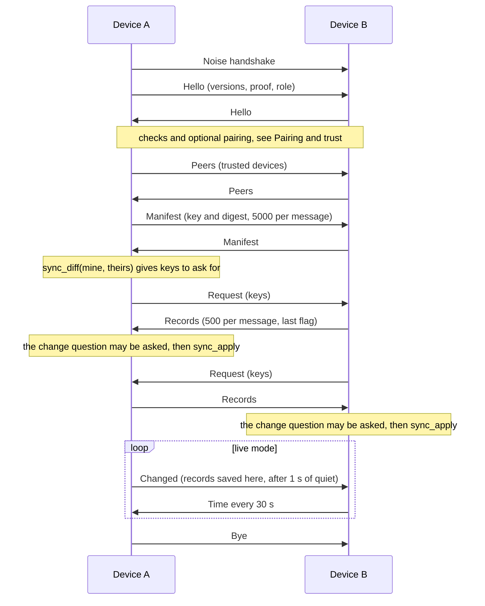
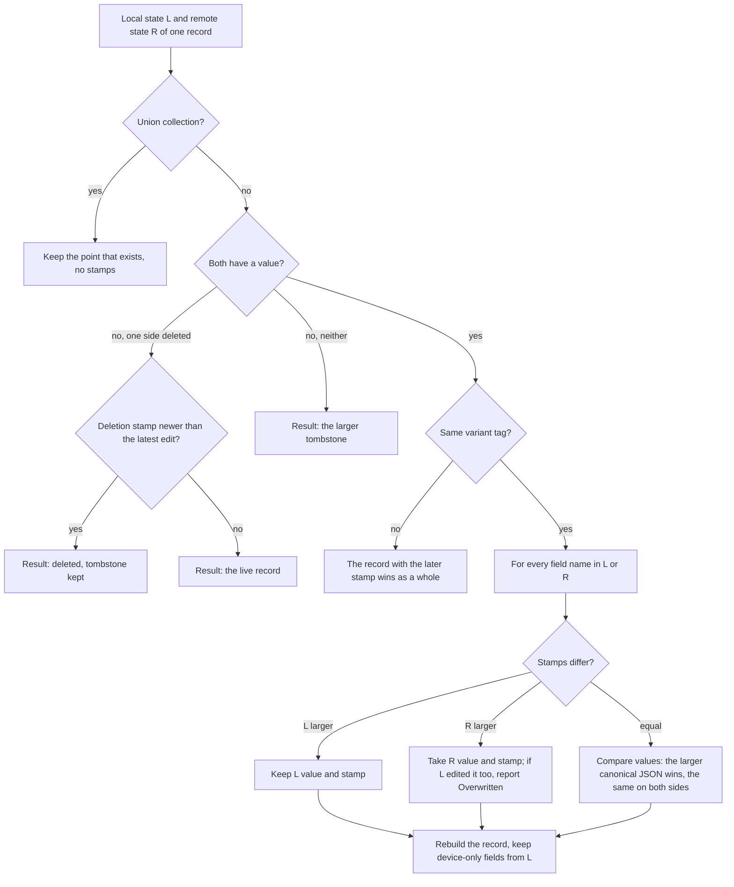

# Exchange and merge

Part of the sync documentation, see [the overview](../sync.md). Previous:
[Pairing and trust](pairing.md). Next:
[The change question, history and undo](plan-question-and-undo.md).

## Change tracking: stamps and tombstones

Vault mutations know nothing about sync. Every `persist()` calls the change
tracker (`sync::track::Tracker`), which keeps an in-memory fingerprint of every
record field from the previous save. For each field whose fingerprint changed it
writes a hybrid-clock stamp; a missing record gets a tombstone. All of it lives
in `VaultDoc.sync` (`SyncState`), an additive field: no format bump was needed.

```text
Stamp { wall: unix ms, count: u32, device: 8-char tag }   // ordered by (wall, count, device)
RecordStamps { created: Stamp, fields: { field name -> Stamp } }
```

- A field stamp is stored only if the field was edited after the record was
  created; otherwise the field is "as created".
- The clock never goes back (`Clock::tick_at`) and takes in every stamp it sees
  (`observe`), so the next local edit sorts after anything received.
- `SyncState` holds: `stamps` (`collection:key` to `RecordStamps`), `tombstones`,
  `tombstones_seen` (local time a deletion arrived here, never synced),
  `peers`, `batches` (undo, last 20 and not older than 7 days), `transfers`,
  `journal` (last 200 lines), `paused`, `cut_by`.
- Only the record metadata (`stamps`, `tombstones`) and `peers` describe shared
  data. Everything else is this device's own bookkeeping and is never sent, and
  is not taken from a pulled external copy or a received vault file
  (`SyncState::take_records_from` is the single list of that).

## A session



The steps, as `link.rs` runs them:

1. **Noise and Hello.** See [Pairing and trust](pairing.md).
2. **Peers.** Both sides send their trusted-device list and merge the other's.
   If the merge shows that this device was revoked, the session ends
   (`SYNC_REVOKED`).
3. **Manifest.** `sync_manifest(Some(since))` returns one 64-bit digest per
   record and per deletion. The digest covers the shared part of a record
   (`shareable`: device-local fields are left out). Cached prices and rates older
   than 90 days (`UNION_DAYS`) are left out of the first manifest.
4. **Diff and request.** `sync_diff` compares the two manifests and returns the
   keys to ask for, leaving out cache points this device would thin away at
   once (otherwise the same list would repeat every session).
5. **Records.** The other side answers with full `RecordState`s: value, stamps
   and tombstone, in chunks of 500 records (a message is at most 16 MiB).
6. **Check the stamps.** Each incoming stamp is checked against the local clock
   (`ClockWatch`). A jump (drift over 2 minutes, time going back, a stamp from
   the future) marks the link "temporarily untrusted": every batch waits for the
   user.
7. **Apply.** `sync_apply` merges and writes; see below. Whether the user is
   asked first is in [the next chapter](plan-question-and-undo.md).
8. **Mark synced, clear cut-off.** `sync_mark_synced` records `last_synced_at`;
   `sync_clear_cut` forgets any "paused/forgotten" notice from that device.
9. **Live mode.** A save during the session announces the changed keys; they are
   sent after 1 second of quiet (`DEBOUNCE`) as `Changed`. The main device
   forwards what it receives to the other clients. `Time` goes every 30 seconds;
   95 seconds of silence ends the session. `Bye` carries a reason: `closed`,
   `declined`, `timeout`, `paused`, `forgotten`.

An edit made 0.5 to 3 seconds before a sync call is still pushed in the same
session: every stamping path puts its keys in one `announce` set that only the
live push drains (B1 item 7).

## The merge of one record



Properties:

- **Commutative.** `merge(L, R)` equals `merge(R, L)`, so both devices end with
  the same record; equal stamps (data both copies had before sync) fall back to
  comparing canonical values.
- Edits to different fields of one record are both kept. If one field was
  changed on two devices, the later stamp wins and the summary lists it as
  "Overwritten: was -> became".
- A deletion beats every edit made before it. An edit after the deletion brings
  the record back.
- A different variant of a tagged record (a transaction that is now a transfer
  instead of an income) goes by the latest stamp as a whole.
- A batch is applied as one operation: the records are written into the JSON
  document, the typed `VaultDoc` is rebuilt with serde, and a record that does
  not fit the schema rejects the whole batch. A record under a key it does not
  carry, or from a collection that does not sync, is `INVALID_INPUT`
  (`check_incoming`).
- After applying: price and rate caches are thinned the way a refresh does, the
  change tracker is rebased (so the batch is not stamped a second time), the
  duplicate pass runs ([Duplicates and run keys](dedupe-and-run-keys.md)), and
  holdings are recomputed.

## Collection rules

Every field of `VaultDoc` has a rule in `sync::registry`; a field without a rule
fails the test `every_vault_field_has_a_sync_rule`.

| Rule | Behaviour | Collections |
|---|---|---|
| `Records` | records by key, merge per field, deletion is a tombstone | stores (accounts), transactions, categories, contacts, budgets, goals, reminders, price_alerts, categorization_rules, utility_items, meter_readings, enrichments, manual_prices, envelopes, debt_terms, shared_events, key_rates, pending_imports, workflows, workflow_vars, workflow_queue, workflow_state, workflow_waits, calc_scenarios, inflation_points, asset_classes, asset_class_of, valuations, tx_properties, data_sources, asset_price_sources, deposit_rate_sources, attachments, attachment_keys |
| `Single` | one object whose fields merge like a record's | settings, exchanges, emergency_fund, health_last |
| `Log { cap, order }` | merged like `Records`, then ordered by a time field and cut to a cap; trimming is not a deletion | notification_log (500, `delivered_at`), workflow_runs (1000, `started_at`), import_runs (500, `at`) |
| `Union { cap }` | union of immutable points, no stamps | price_cache, fx_cache (first session sends 90 days), discarded_imports (cap 20 000) |
| not synced (`LOCAL`) | identity, schema and derived data | `version`, `id`, `created_at`, `holdings` (recomputed), `sync` |

The older text listed an `automation_runs` log and "schemes". Neither exists in
the registry: automations became workflows, and automation run history is
covered by `workflow_runs`.

### Flatten, skip, whole, secret, cache

These registry flags shape how a record splits into mergeable fields.

| Flag | Meaning | Examples |
|---|---|---|
| `flatten` | one object field is split a level further, so two devices editing different entries both win | `transactions.meta` (comment on one device, categories on another); `workflow_state.marks` (one entry per trigger) |
| `skip` | fields that belong to the device and never travel; a merge keeps the local value, and the digest ignores them | `workflow_state.tx_cursor`, `workflow_state.tx_index` (the device-local transaction cursor of a trigger); `settings.display_decimals`, `fx_refresh_interval_sec`, `minimize_to_tray` |
| `whole` | the record is one value with one stamp (its fields only make sense together, or it may be null); the later write wins entirely | `health_last` |
| `secret` | a credentials collection: no label or value is shown in the question, batches or journal | exchanges, attachment_keys |
| `secret_fields` | individual credential fields are shown as a mask | `data_sources.url`, `workflow_vars.value` |
| `cache` | derived data each device refreshes on its own: unions in silently, never reaches the question, the window or the journal | price_cache, fx_cache |

**`workflow_state` in detail.** `marks` is `trigger node id -> last moment fired`
(or the last side of a threshold). It merges per entry, each entry by its own
stamp, so a mark of one trigger is never lost to a mark of another. An older
device stamps the whole `marks` map as one field; the merge reads that as "says
nothing about entries it does not list" (`legacy_head`) and the new side adds a
whole-map head when it sends to such a device (`with_legacy_heads`, only on the
wire, never stored). `tx_cursor` and `tx_index` are device-local: they are
excluded from the digest and the merge keeps the local value. The first run
after an update on a device with no local cursor starts from the synced value
once; firing is idempotent through run keys, so a cursor that differs between
devices cannot double-post.

**Device-only settings.** The three `DEVICE_SETTINGS` live in
`app_settings.json` now; the vault's old copies stay but never travel.

### Secrets

The `exchanges` and `attachment_keys` collections are hidden entirely; in other
collections the marked fields appear as a mask in the `before`/`after` of
previews, batches and the journal, and the record signature does not contain
them. On open, old previews of these fields are masked too (idempotently).

## Tombstones and compaction

A tombstone is the stamp of a deletion, kept so the record does not come back
from a device that still has it.

- A tombstone is compacted after 180 days (`TOMBSTONE_DAYS`) **and** only when
  every trusted, non-revoked device has synced since. A device that never
  synced counts as "not yet", so its tombstones are kept.
- The age counts from the later of the deletion stamp and the local time it
  arrived here (`tombstones_seen`). A deletion that arrives late is not
  compacted at once, so the record cannot resurrect from other devices.
- Deletions in capped logs: the tracker reads a missing log entry as a trim, not
  a deletion. A real deletion in a log (for example forgetting a run) goes
  through `sync_forget_log_record`, which writes a tombstone and offers the key
  to a live session.
- A deletion older than the retention on one side can come back from a device
  that was offline longer than that.

## Caches (price_cache, fx_cache)

Cached prices and rates union in. The first session sends only the last 90
days. After each apply that touched them, both devices thin the result with the
same algorithm a refresh uses (rates of currencies not in use are thinned to one
point). Thinning is not a deletion and leaves no tombstone. The manifest and the
diff leave out points the receiver would thin away at once, so after the first
exchange a second one carries zero cache records. Cache points never produce a
question.

Next: [The change question, history and undo](plan-question-and-undo.md).
