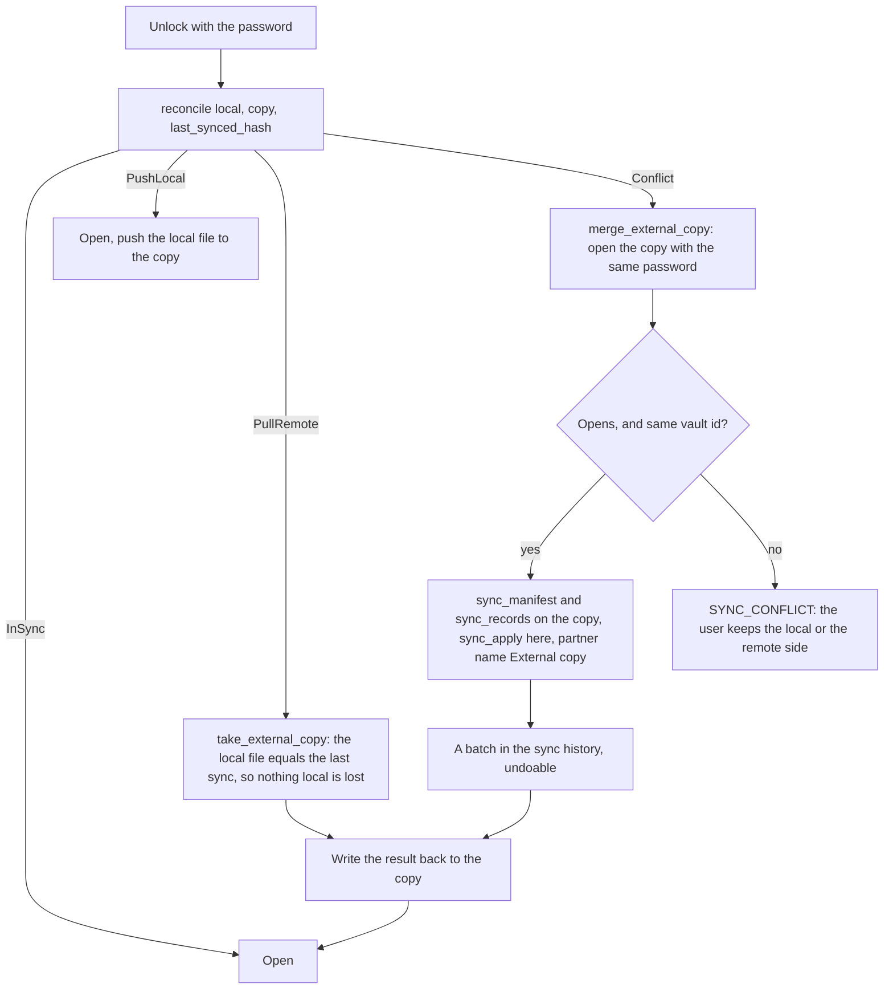

# The external copy

Part of the sync documentation, see [the overview](../sync.md). Previous:
[Vault transfer](transfer.md). Next:
[Compatibility between versions](compatibility.md).

A vault can be linked to an **external copy**: the sealed vault file mirrored to
a place the user chose (a folder in a cloud drive, a Syncthing folder, a USB
stick, a document the app can write on Android). It is a separate feature from
device sync, with its own settings under the vault, but the two meet at unlock.
File handling per operating system is described in
`docs/storage-platforms.md`; this chapter covers only how it relates to sync.

## The mirror

- The working vault is always a local file. After every save the sealed bytes go
  to the mirror (`VaultMirror::push`) and the link records the hash of the
  bytes both sides held (`last_synced_hash`).
- The link table is `vault_links.json` in the app config directory: only the
  target address, hashes, the last error and the `remote_changed` flag. No
  secrets: the copy is the sealed file.
- **Push is compare-and-swap** (`compare_and_push`). Before writing, the copy is
  read; the write happens only when it still holds the bytes of the last sync (or
  does not exist). If it changed on another device, nothing is written, the link
  is marked `remote_changed` (status "VAULT_REMOTE_CHANGED"), and pushing stays
  stopped until the next unlock. This replaces the earlier blind overwrite.

## On unlock: reconcile

`mirror::reconcile(local, remote, last_synced_hash)` compares the two files with
the hash of the last sync:

| What changed since the last sync | Action |
|---|---|
| Nothing, or equal bytes | `InSync` |
| Only the local file changed, or the copy is missing | `PushLocal`: write it out |
| Only the copy changed (edited on another device) | `PullRemote`: take its data |
| Both changed, or no last hash | `Conflict`: merge |

- `<vault>.bak` keeps the file as it was before a pull or a merge.
- **Merge.** The copy is read with the same password, the vault id must match,
  and its records are applied through the ordinary peer-sync path with the
  partner "External copy" (device id `external-copy`). The batch is visible in the
  sync history and is undone like any other. Only records travel: the copy's
  batches, journal, trusted devices, pauses and cut-offs are never imported, and
  the copy's `doc.sync` is not taken. Merge is by stamp, per field, so edits made
  on both sides survive.
- **Pull.** When only the copy changed, its data replaces the local data, but
  stamps and tombstones come with the data (they describe the records) and the
  trusted-device lists are merged by their own rules. The local undo batches,
  journal, transfers, pauses and cut-offs stay.
- After a merge or a pull, the copy's bytes are part of this vault: the next push
  compares against them, and the result is written back to the copy.

## Copies with no shared history

Merge is by stamp, and a stamp says who changed a field and when. Two copies of
a vault that drifted apart before stamps existed (or whose stamps were lost) have
no such history, and the app has no common base to compare them with: the sealed
file of the last sync is not kept, only its hash. That is a limit of the model,
not something a rule can fix.

What happens, and what is shown:

- For a field that differs with no stamp on either side, the merge picks the
  larger canonical value, the same on every run and from either side. The pick
  can be the wrong one in meaning.
- When that pick replaces the local value, it is listed in the batch as
  "Overwritten" like any lost edit, and the summary carries
  `unstamped_conflicts`, the number of records with such a field. The sync
  summary then adds a line: the copies have no shared history, the app could not
  tell which side changed what, and records deleted in one copy can come back.
- A record deleted in one copy and alive in the other comes back: the copy that
  deleted it has no tombstone, and the live side wins.
- Only this path reports it. Device sync over the network never counts or lists
  unstamped values.

Keeping a base for a three-way merge of external copies would mean storing an
encrypted copy of the whole vault on disk; it was considered and left out (a
separate decision about privacy and size).

## Conflicts that need the user

If the copy does not open with the password, or is another vault, the merge is
`Unmergeable`. For a pull, the file is simply replaced (the old behaviour). For a
conflict, unlock stops with `SYNC_CONFLICT` and the user picks a side
(`resolve_vault_conflict` with `keep: local | remote`):

- **Keep local:** the local file is written to the copy.
- **Keep remote:** the copy replaces the local file; the local file stays as
  `<vault>.bak`.

## Difference from device sync

| | Device sync | External copy |
|---|---|---|
| Transport | local network, Noise | any file location |
| When | live, while both are unlocked | at unlock, and after each save as a push |
| Granularity | records, per field | the whole file as a push; records as a merge |
| User control | change question, history, undo | the merge is a batch in the history; conflicts ask |

Next: [Compatibility between versions](compatibility.md).
