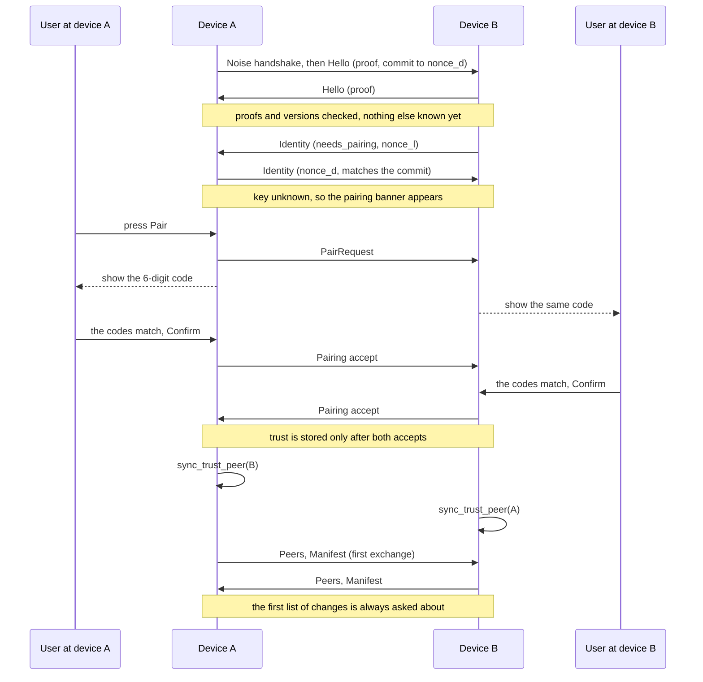
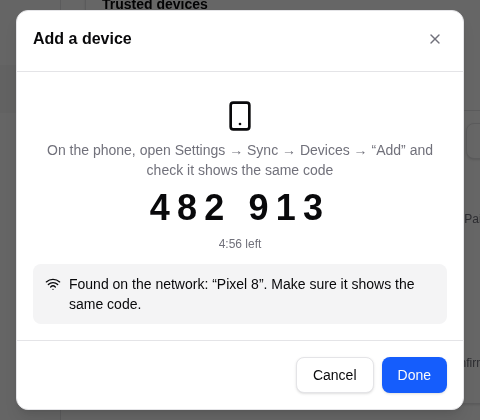
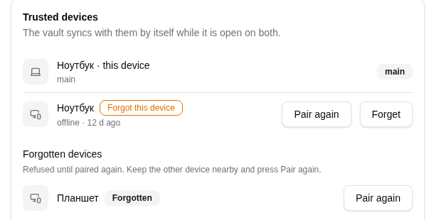

# Pairing and trust

Part of the sync documentation, see [the overview](../sync.md). Previous:
[Devices and roles](devices-and-roles.md). Next:
[Exchange and merge](exchange-and-merge.md).

## Discovery

With sync turned on and the vault unlocked, a device announces itself over mDNS
and looks for others (see [Devices and roles](devices-and-roles.md)). A device
that is found but not trusted shows up in the device list under "Nearby, not
paired yet" and as a banner "<name> with this vault is nearby" with the buttons
**Pair** and **Not now**.

Only devices with the same vault see each other: the mDNS tag is derived from
the vault id and changes daily, and the handshake proves knowledge of the vault
id (see below).

## A session opens: Noise, Hello and Identity

Every connection, dialed or accepted, starts the same way
(`crates/app/src/sync/link.rs`, `session`). Since protocol 4 nothing about the
device leaves before the other side proved it holds the vault:

| Step | Dialer | Listener |
|---|---|---|
| 1 | Noise handshake `XX_25519_ChaChaPoly_BLAKE2s`: both present their static device key | same |
| 2 | `Hello { protocol, format, proof, app_version, commit = SHA256(nonce_d) }`, identity fields empty | `Hello { protocol, format, proof, app_version }`, identity fields empty |
| 3 | checks 1 and 2 below (the proof, then the versions) | same |
| 4 | waits | `Identity { device_id, device_name, now_ms, main, prefer_main, needs_pairing, rank, instance, unreached, nonce = nonce_l }` |
| 5 | `Identity { ..., nonce = nonce_d }` | `SHA256(nonce_d)` must equal the commit, else `SYNC_CHANNEL` |
| 6 | checks 3 to 7 below, on the identity | same |

`nonce_d` and `nonce_l` are 32 random bytes each. A device that fails the proof
gets only an anonymous `Hello` (versions and the app version) and learns neither
the name nor the id of this device. The `Hello` keeps its protocol 3 shape with
the identity fields sent empty, so an old build can still decode it and refuse
on the version (see [Compatibility](compatibility.md#protocol-4-identity-after-the-vault-proof)).

The checks run in this order; the first to fail ends the session:

| Order | Check | Outcome |
|---|---|---|
| 1 | The vault proof `HMAC(vault.id, handshake_hash, role)` | `SYNC_OTHER_VAULT`. The proof does not reveal the id and cannot be reflected back |
| 2 | `protocol` and `format` equal to ours | `SYNC_VERSION_MISMATCH` naming the device and both app versions |
| 3 | The device is this one, or was dismissed in this run | quiet close |
| 4 | The device is paused here | `Bye "paused"`, quiet close |
| 5 | Both sides claim the same main flag | quiet close; discovery sorts it out |
| 6 | The key is forgotten here | wait 1 s for a `PairRequest`; without it send `Bye "forgotten"` |
| 7 | Clock skew | up to 5 min fine; up to 24 h a warning; more is `SYNC_CLOCK_SKEW` |

A trusted key goes straight to the exchange. An unknown key, or one whose
`needs_pairing` is set by the other side, goes to pairing first.

## Pairing

The pairing code is six digits:
`HMAC(handshake_hash, "mwt-sas4" || nonce_d || nonce_l)`. A device in the middle
of the connection (MITM) has two different handshakes, so its two screens show
two different codes; the user sees the mismatch. The dialer commits to `nonce_d`
in its `Hello`, before it sees `nonce_l`, and the listener sends `nonce_l` before
it sees `nonce_d`: neither end of a MITM can try keys or nonces until the two
codes match, so it gets one guess, 1 in 10^6. (Protocol 3 used the hash alone,
about 2^20 tries away from a match for someone who also knew the vault id.)

Details:

- The code stays on screen for at most 5 minutes (`PAIRING_TIMEOUT`).
- Trust is stored only after **both** sides accepted. `Pairing { accept: false }`
  from either side ends the session with `SYNC_REJECTED`.
- "Not now", a timeout, or a rejected pairing puts the device on the in-memory
  `declined` list: it is not offered again until sync restarts. This is not a
  vault change and is unrelated to the pause below.
- Brute force: 3 failed handshakes or declined pairings from one address make
  the address ignored for 10 minutes (`MAX_FAILURES`, `FAILURE_WINDOW`). A frame
  is at most 16 MiB.
- `sync_trust_peer` also clears the device's old pause and cut-off.

*The same six digits on both screens; confirm only when they match.*

## The list of trusted devices

`SyncState.peers` holds `TrustedPeer { device_id, name, public_key, paired_at,
last_synced_at, revoked, stamp }`. The list travels in `Peers` messages at the
start of an exchange and whenever it changes, so "Forget" reaches every device.

Merge rule (`SyncState::merge_peers`), per device id:

- The entry with the larger `stamp` wins, provided it is about the same key, or
  either entry is a revocation.
- An entry stamped more than 24 hours ahead of the local clock is skipped, with
  a stderr line naming the device id (no secrets).
- `last_synced_at` is local bookkeeping and is not taken from the received entry.
- A new device id whose key is currently revoked here is not added unless the
  incoming entry is itself a revocation.
- The newest entry for a key decides whether it is trusted
  (`trusted()`, `is_revoked()`).

A consequence worth knowing: **a newer explicit trust beats an older
revocation, and an older trust never lifts a newer revocation.** So a pairing
that happened after the "Forget" travels to the other devices and lifts the
revocation there too. (The older text of this document said that only a local
pairing could lift it; the code, and the vault-transfer fix, work as stated
here.)

## Forgetting and pairing again

"Forget device" (`sync_forget_peer`):

1. Stamps the entry as revoked (`revoked = stamp`), clears any pause and cut-off
   for that device.
2. Closes its live links; the other links get an `Order::SendPeers`, so the new
   list goes out at once.
3. A revocation that arrives on a live session closes the session with the
   forgotten device (`SYNC_REVOKED`). On a client that forgot its main device,
   the main is removed from the candidate list so pairing can start at once.

A forgotten device still gates tombstone compaction for 365 days after the
revocation: if it is paired again within a year, deletions made meanwhile stay
deleted. After a year the tombstones may be gone, and records deleted on the
group can come back from that device.

During pairing and during the change question the session now handles `Peers`
too: a revocation that arrives mid-session is not lost (during pairing the
other side's list is held and merged once the pairing is through). Before a
batch is applied the remote key is checked again; a device forgotten while the
question was open gets nothing, and the question closes as declined.

A forgotten device is shown in the list under "Forgotten devices" with
**Pair again**. It is refused until a pairing code is confirmed on both devices:
until then it receives no data. A confirmed pairing makes a newer entry and
brings it back. The vault copy on the forgotten device cannot be revoked; for a
lost device the advice is to change the vault password.

**Pair again** (`sync_pair` with a device id) clears what the device told this
one, remembers the user's intent, and dials the device once with the pairing
request. The device must be in sight (seen by discovery in this run), with sync
on, on the same network.

## Pause: declining a list of changes

Declining a list of changes pauses exchange with that device
([the question](plan-question-and-undo.md)). The device id goes into
`SyncState.paused`, in the vault, so the pause survives a restart and a lock. It
is never synced and is not part of `peers`.

While the pause stands, a session with that device ends right after the version
check: this side sends `Bye "paused"` and closes without an error toast. The
device list shows "Exchange paused" and **Resume** (`sync_resume_peer`): Resume
lifts the pause, tries a connection at once, and the list of changes is asked
about again with a fresh summary. "Forget" also lifts the pause, as does a new
pairing.

**A timeout is not a refusal.** No answer within 10 minutes (or a closed window)
closes the session with `Bye "timeout"` and sets no pause; the next session asks
again.

## Cut-off notices

When device X pauses this device or forgets it, X tells it why before it
closes: `Bye { reason: "paused" }` or `"forgotten"`. The wire format has no new
message variant, so older builds see a plain `Bye` and close quietly. A
forgotten device gets `forgotten` only if it did not ask to pair (a
`PairRequest` right after the identities is the way back).

The receiver:

1. Writes `SyncState.cut_by[X] = { reason, at }` in its vault (local, not
   synced).
2. Shows `SYNC_PAUSED_BY_PEER` or `SYNC_FORGOTTEN_BY_PEER` once, naming the
   device. The error notice is deduplicated per (code, device) and shows again
   only after a completed exchange with that device.
3. Stops dialing X: the client does not dial X as a main device, the main
   device's return calls and the elections skip X. A client that the main device
   refused does not become main itself; it waits for the main device's call.
   X's own calls are still accepted, so X can come back on its own.

The device list marks such a device: "Paused on the other side" or "Forgot this
device". The mark is lifted by a completed exchange, a pairing, **Pair again**
and **Forget**. A side that has a pause does not call the devices it paused
either.

*The device list after the other device paused or forgot this one: the mark and the way back.*

Next: [Exchange and merge](exchange-and-merge.md).
