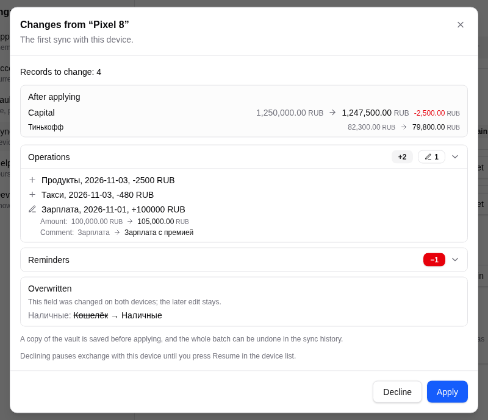
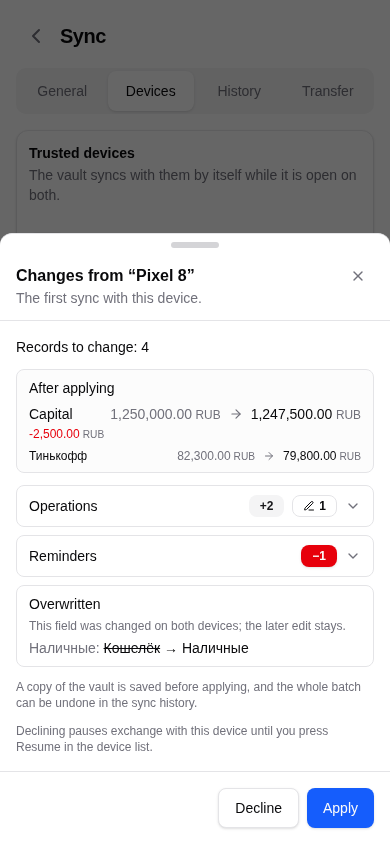
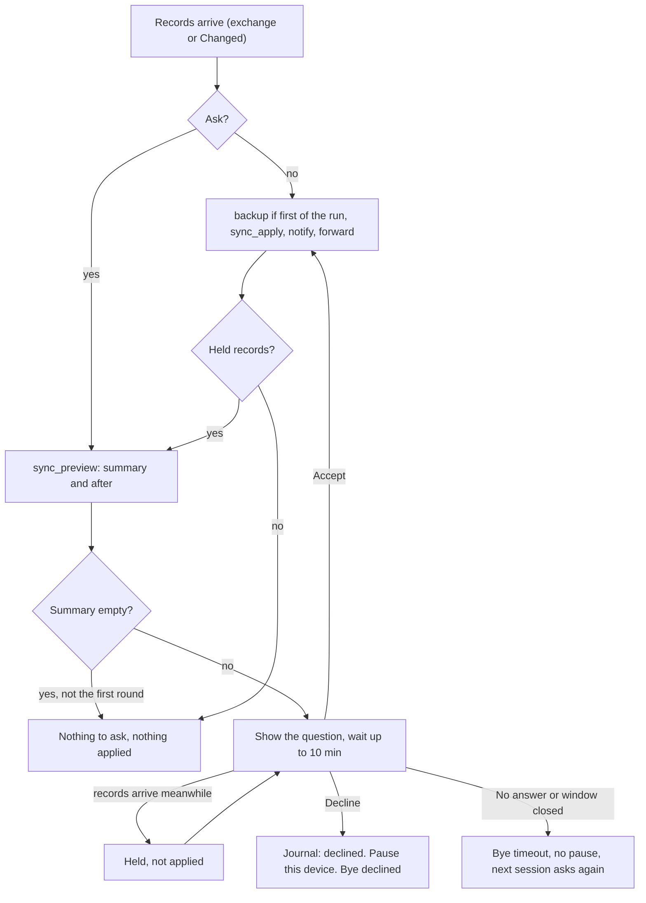
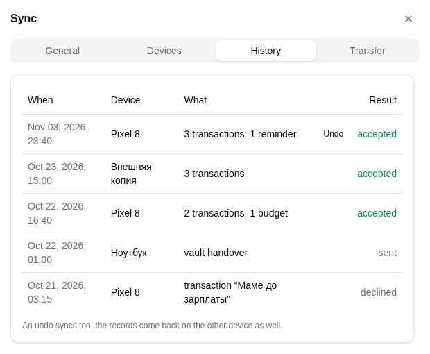
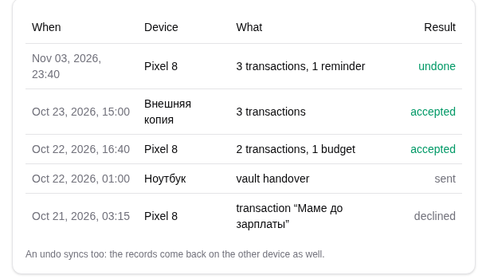

# The change question, history and undo

Part of the sync documentation, see [the overview](../sync.md). Previous:
[Exchange and merge](exchange-and-merge.md). Next:
[Duplicates and run keys](dedupe-and-run-keys.md).

## When the user is asked

After a device has collected the records the other side sent, it either applies
them at once (with a notification and an "Undo" action) or shows a **list of
changes** and waits. It asks in three cases (`SyncConfirmReason`):

| Reason | When | Text |
|---|---|---|
| `Paired` | the first exchange right after pairing | "The first sync with this device." |
| `First` | the setting "Ask before syncing" is on; only the first batch of each link | "These are the first changes of the session." |
| `Unreliable` | the other device's clock jumped during the session; every batch | "This device's time jumped: every change from it waits for you." |

A list with no visible change is not asked about, and cache points
(`Collection.cache`) never appear in it.

## What the question shows

`sync_preview` computes the summary without changing anything:

- per collection, how many records are **Added**, **Changed** (updated) and
  **Deleted**; up to 50 items per collection, the counts cover the rest;
- for each changed record, `fields`: readable "field: before -> after" lines
  (up to 12, internal bookkeeping left out, money shown with its currency or
  asset, credential fields masked);
- "Overwritten": fields changed on both devices where the other device's edit
  wins;
- `after`: capital and the balances of the wallets the batch moves, before and
  after, computed by applying the batch to an in-memory sandbox copy of the
  vault (`sync_preview_after`); the question still shows without it when it
  cannot be computed.

*The list of changes from another device, with fields and the "After applying" block.*

*The same question at phone width.*

## The answer, the timeout and held records

- **Accept** applies exactly the records the summary showed.
- **Records that arrive while the question is open are held**, never applied with
  the answer. After the answer they go through a new summary and a second
  question with the fresh diff; the second question has the same reason as the
  first. A held list that changes nothing asks nothing and is dropped. Held
  records are keyed by record, so they stay bounded by the vault.
- **Revocation during the question.** `Peers` messages are handled while the
  question is open. If the device is forgotten meanwhile, the question closes
  and nothing is applied. The trust is checked once more right before
  `sync_apply`; a device that is no longer trusted is recorded as declined.
- **Decline** records "declined" in the sync journal and pauses exchange with the
  device (see [Pairing and trust](pairing.md)). The user presses Resume in the
  device list to ask again.
- **No answer in 10 minutes** (`DECISION_TIMEOUT`), or the window being closed,
  is not a decline: the session closes with `Bye "timeout"` and the next session
  asks again. While waiting, the device keeps sending `Time` so the other side
  does not close a silent session.
- On a failure to apply, the journal records "error" with counts only, never
  values.

## Before the first batch: a backup

Before the first batch of a sync run (until sync is restarted) the vault file is
copied aside as `<vault>.presync.bak`; the last three are kept
(`PRESYNC_BACKUPS`). "Restore from before the sync" in Settings, Sync
(`sync_restore_backup`) puts the whole vault back. It is saved as new local
changes, so it reaches the other devices like any edit.

## History and the journal

- **Sync history** (`sync_history`): the batches still kept (the last 20, not
  older than 7 days) and the transfers to new devices, newest first. Each batch
  shows the peer name, the time, the summary and the Undo action; an undone
  batch is marked.
- **Sync journal** (`sync_journal`): the last 200 lines of every incoming batch,
  with the outcome (accepted, declined, error, sent) and counts per collection.
  No record values and no keys. Credentials are masked.

*Each batch from another device, with its summary and an Undo button.*

## Undo of a batch

A batch stores, for each record it changed, the record **before** and the
stamps **after**. `sync_undo(batch_id)`:

1. Stamps any pending local edits first (so they are not mistaken for batch
   effects).
2. For every entry, compares the record's current stamps with the stamps the
   batch left. If they are unchanged, the record is restored to its "before"
   state. If the record has been changed since, it is **skipped** and its label
   is listed in the reply (`UndoReport { restored, skipped }`).
3. If **nothing** was restored, the batch is left as it was: it stays undoable
   and the reply tells which records were skipped and why. `undone_at` is set
   **only when at least one record was restored**.
4. Raises schedule marks that the undo moved back to the newest booked run key
   (`keep_schedule_marks`), so undoing a posted operation does not make its
   trigger fire again.
5. Recomputes holdings and saves.

The undo is a **new local edit** with fresh stamps, and it goes to the other
devices. Two copies of one vault cannot diverge forever on one record: the
restored state is the newest state everywhere.

Undo and deletions:

- A Log record the batch added (`before` is empty) is removed through the
  tombstone path and counted as restored, so it does not come back from another
  device.
- A Union entry (a price or rate point, a discarded import) cannot be deleted.
  It is listed in `skipped` with a reason and not counted as restored.

What undo covers:

- Records changed by the batch, including records that the duplicate pass
  removed or edited during that apply: the pass writes its deletions and its
  carried fields into the same batch, so undoing the batch brings both copies
  back.
- It does not undo a later batch, and it does not restore a record that was
  edited after the batch.

*The result of an undo: what was restored and what stayed because it changed later.*

Next: [Duplicates and run keys](dedupe-and-run-keys.md).
