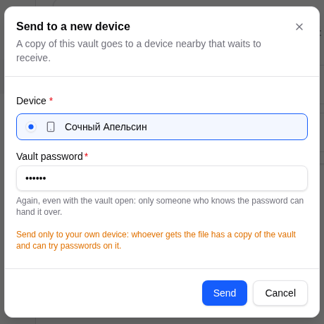
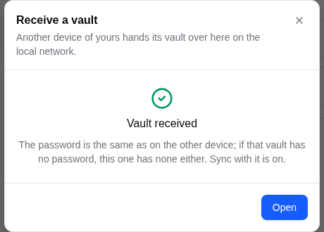
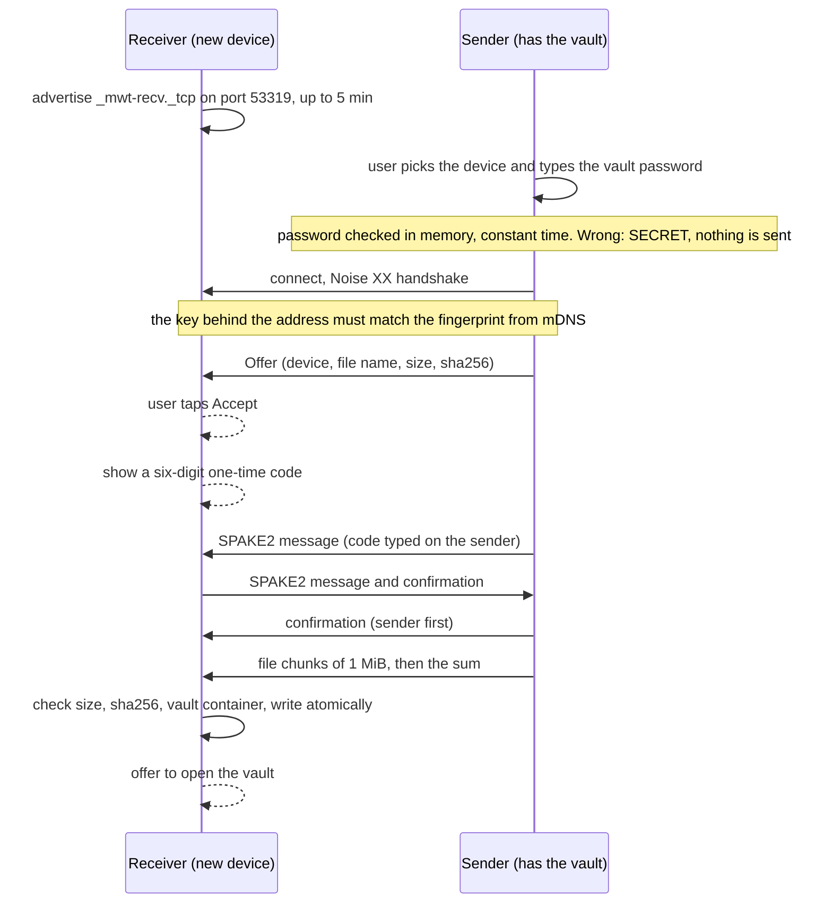

# Vault transfer

Part of the sync documentation, see [the overview](../sync.md). Previous:
[Duplicates and run keys](dedupe-and-run-keys.md). Next:
[The external copy](external-copy.md).

A new device receives the whole vault over the local network. Where to find it
in the app: Settings, Sync, Transfer on the device that has the vault ("Send to
a new device"), and on the new device either Settings, Sync or, on the unlock
screen, **Receive from another device**.

Code: `trade_core::sync::transfer` (the protocol, SPAKE2, the file check),
`crates/app/src/sync/transfer.rs` (sessions), `crates/app/src/sync/handover.rs`
(mDNS, screens, saving), `crates/app/src/sync/pending.rs` (pending trust).

## For the user

1. On the new device open **Receive from another device**. It shows its name
   (an adjective and a fruit, as in sync) and waits for up to 5 minutes.
2. On the device with the vault open Send to a new device, pick the name and
   type the vault password once more (even though the vault is open).
3. The new device asks "<name> wants to hand you its vault". Accept only if it is
   your own device.
4. The new device shows a six-digit code. Type it on the sending device and
   press Confirm.
5. The file is sent. When it is done, press **Open** on the new device. The
   password is the same as on the old device; a vault without a password has none
   on the new device either.
6. Both devices now trust each other. Sync is switched on on the new device.

Send only to your own device: whoever gets the file has a copy of the vault.

*The sending side: pick the device, enter the password, then the code.*

*The receiving side: the request, the code to read out, and Open.*

## The protocol

Facts:

- The receiver's mDNS record has only the device name, the type (`mobile` or
  `desktop`) and a fingerprint of its key (`sha256(pubkey)[..8]`). The sender
  checks that the key behind the address matches that fingerprint, so a device
  that took over the address does not get the vault.
- The one-time code is generated by a CSPRNG, bound to the Noise handshake hash,
  and verified with **SPAKE2** (symmetric, Ed25519): an eavesdropper gets one
  attempt per connection and nothing to brute-force offline. After 3 wrong codes
  the request is reset (`SYNC_BAD_CODE`). A plain MAC of a six-digit code would
  be cracked offline in fractions of a second, so it is not used.
- The file is the encrypted `.wallet` as it is; the password never travels. The
  receiver checks the size, the SHA-256 and that it is a vault container
  (`crypto::parse_file`) before it writes. A vault is at most 1 GiB. The file goes
  through `atomic_write` into the vaults folder under its original name, with
  " (2)" and so on when the name is taken, and is added to the recent list.
- Timeouts: handshake 10 s, each step 60 s, waiting for the person 5 minutes.
  The receive window lasts 5 minutes and can be extended ("Wait 5 more minutes").
- The receive window listens on 53319; when it is busy, on the next free port of
  53320-53327, and on a random port only when all are busy. The "Open the port"
  firewall rule covers TCP 53318-53327, so the spare ports are inside it (a
  random port is not).
- The transfer protocol has its own version (`TRANSFER_PROTOCOL = 1`).

## Trust after a transfer

A transfer is a **fresh trust on both sides**.

- **Sender.** `sync_record_transfer` appends the transfer to `SyncState.transfers`
  (last 50, shown in the sync history), writes a "sent" line in the journal, logs
  a `security` category notice ("The vault was handed to another device. If it was
  not you, change the password.") that reaches all linked devices, and trusts the
  receiver at once. It also lifts any pause and cut-off for that device
  (`record_delivery`).
- **Receiver.** Right after saving the file it turns sync on, and writes a
  **pending trust** entry into the app settings: file path, sender device id,
  name and key, with a 7-day lifetime (`PENDING_TTL_MS`). It is written to disk
  and not held in memory, because Android may kill the process before the first
  unlock. On the first unlock of that file `trust_sender` takes the entries for
  that path (dropping expired ones of any file), trusts the sender with a fresh
  stamp, and clears the sender's pause and cut-off.
- **Merge of the peer list.** A newer explicit trust lifts an older revocation;
  an older entry never lifts a newer one ([Pairing and trust](pairing.md)). So a
  device that was forgotten or paused before is linked again by a transfer.
- The sync protocol version was raised to 2 for the `security` notice category.
  An older build cannot read it and gets `SYNC_VERSION_MISMATCH` rather than a
  parse error.

### Sender bookkeeping in the copy

The file carries the sender's `doc.sync` as it was written. The core has a
function for starting clean, `UnlockedVault::adopt_received_copy`: it keeps the
record metadata and the trusted devices, and drops undo batches, the journal,
transfers, pauses, cut-offs and the peers' last-sync times (the same set
`take_records_from` keeps local for a pulled external copy).

**Discrepancy found in the code (not in the specification):** `adopt_received_copy`
has tests but no caller in the application. In the current tree the receiving
path (the receiving code in `handover.rs` and `trust_sender`) does not call it, so a received
vault keeps the sender's journal, batches and transfer list until they age out;
only the sender's own pause and cut-off are cleared by the pending trust. The
specification of the transfer fix (S3) and the previous text of this document say
the copy starts clean. Treat the clean start as intended but not yet wired.

## Errors

| Code | Meaning |
|---|---|
| `SECRET` | wrong vault password on the sender; nothing was sent |
| `SYNC_BAD_CODE` | the code did not match; 3 tries per request |
| `SYNC_TRANSFER_DECLINED` | the receiver pressed Decline |
| `SYNC_TRANSFER_EXPIRED` | the receive window ran out |
| `SYNC_NOT_A_VAULT` | the received bytes are not a vault container |

Next: [The external copy](external-copy.md).
