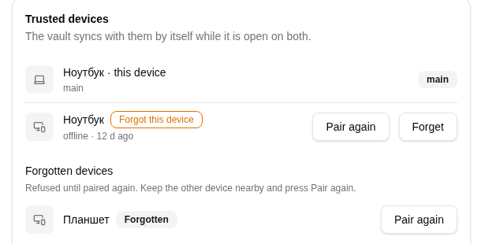
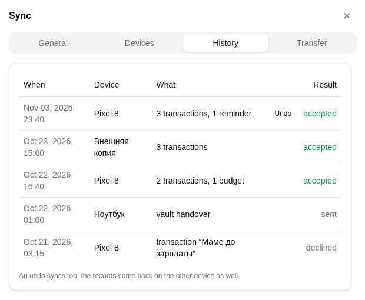

# Troubleshooting

Part of the sync documentation, see [the overview](../sync.md). Previous:
[Compatibility between versions](compatibility.md).

Find the symptom, read the cause, do what is listed. Buttons are in Settings,
Sync, Devices unless said otherwise.

## Devices do not find each other

| Cause | What to do |
|---|---|
| Sync is off on one of them | Turn on "Sync over Wi-Fi" on both |
| The vault is locked | Sync runs only while the vault is open on both. On Android keep the app in the background, not closed |
| Different vault | A different vault is refused (`SYNC_OTHER_VAULT`). Use "Receive from another device" to copy the vault first |
| Guest or office Wi-Fi with client isolation, or multicast blocked | Use a normal home network or a phone hotspot |
| A firewall drops incoming connections | The main device shows "A firewall blocks incoming connections". Press "Open the port" (Linux, Windows; the rule covers TCP 53318-53327, press it again after an update to widen an old 53318-53319 rule) or allow the app when the system asks. On Windows the banner stays until a device connects, and the rule is for Private networks only: if the network is Public, switch it to Private in Windows settings. On Flatpak, run the shown commands in a terminal |
| Different networks (Wi-Fi vs mobile data) | Put both on the same Wi-Fi |

After 30 seconds without neighbors, Settings, Sync shows a hint, the port and the
address to check.

## A forgotten device keeps coming back, or keeps being refused

Symptom: you forgot a device and it still tries, or you forgot a device by
mistake and it is refused with an error that repeats.

- **Cause.** "Forget device" refuses its key on every device. The refusal is
  announced once to the forgotten device, which then stops dialing. The way back
  is a new pairing.
- **To bring it back.** Open Forgotten devices, keep the other device nearby and
  press **Pair again**. Confirm the same six-digit code on both screens.
- **If "Pair again" fails** ("the device must be nearby, on the same network, with
  sync on"): open Settings, Sync on the other device, wait until it is listed
  under "Nearby", then press Pair on the banner.
- **To keep it out.** Do nothing: it is refused. For a lost device change the
  vault password as well; the copy on it cannot be revoked.

## A device says it was paused or forgotten

Symptom: a notice "<name> paused the exchange" or "<name> forgot this device", and
the device shows "Paused on the other side" or "Forgot this device".

- **Paused:** the other device declined your list of changes. Nothing is wrong on
  your side. On the other device press **Resume**.
- **Forgotten:** the other device forgot yours. Press **Pair again** on either
  side and confirm the code.

*The mark in the device list and the way back.*

## A device is stuck on "Exchange paused"

- **Cause.** You pressed Decline on a list of changes. Decline pauses the device
  until you resume it. A timeout or a closed window does not pause.
- **What to do.** Press **Resume**. The list of changes is asked about again with
  a fresh summary.

## The list of changes did not appear, or appeared twice

- It is asked about only after pairing, with "Ask before syncing" on, or when the
  other device's clock jumped.
- Records that arrive while a question is open wait for a second question; a
  second list that changes nothing asks nothing.
- If you did not answer in 10 minutes the session closed with no pause. The next
  session asks again.

## Duplicates

| Symptom | Cause | What to do |
|---|---|---|
| The same salary, tax or rent transaction twice | Two devices ran the same job before they met, or one of them is on an old version | Wait for the next exchange: the copy made later is removed and its later edits are moved into the kept one. If it is still there, update the app on every device |
| Two reminders for the same loan or deposit | Reminders from an older build have random ids | The next exchange merges them by source; the kept reminder keeps done, muted and snoozed state |
| Two questions for the same planned transfer | An old device started the run | Answer one: the other is removed; one answer gives one set of transfers |
| A removed duplicate you wanted | Dedupe deleted the wrong copy | Open Settings, Sync, history and undo the batch: it restores both copies |

Two loans due on the same day keep two reminders: reminders are matched by their
source (the loan), not only by the date.

## "App versions are incompatible"

- The message names the device and both versions: update the app on the device
  whose version is older (or on both).
- Trust is kept. The pair joins by itself after the update.
- "an old version" means that device runs a build that does not report its
  version.
- Records are not lost. Update every device: an old build keeps its own
  tombstone rules and can still bring back a deletion.

## Deleted records came back

- Deletions stay for as long as some trusted device may not have them, and for a
  year after a device is forgotten. If a forgotten device is paired again after
  more than a year, records deleted meanwhile can return: delete them again.
- A mixed pair with an old build can bring a deletion back until both devices
  are updated.

## A clock warning, or every change waits for confirmation

- A skew of up to 5 minutes is normal. Up to 24 hours you get a warning; more is
  a refusal (`SYNC_CLOCK_SKEW`).
- A device whose clock is far in the future (more than 24 hours) no longer
  pushes the others' clocks along: its records are stored, but later edits and
  revocations still sort normally. Its own entries are re-stamped. Fix the
  date on that device. The log line "peer entry for device <id> skipped: its stamp is
  too far ahead" names the device.
- If a device's time jumped during a session, it is "temporarily untrusted": every
  batch from it waits for you. Fix the date and time on that device (turn on
  automatic time) and reconnect. The mark clears by itself after 3 stable time
  reports in a row.
- A device refused for clock skew is not redialed until you press Retry, and the
  error is shown once, not every 5 minutes.

## I accepted changes by mistake

Open Settings, Sync, history and press **Undo** on the batch. Records edited
since stay as they are and are listed. Undo itself syncs to the other devices.
If the whole session was wrong, use "Restore from before the sync": the vault as
it was before the first batch of the run.

*History with Undo.*

## The external copy

| Symptom | Cause | What to do |
|---|---|---|
| "saving to it is paused and it is merged in the next time the vault is opened" (`VAULT_REMOTE_CHANGED`) | the copy was saved by another device since your last sync | Lock and unlock: it is merged, and the merge shows in the history as "External copy" |
| Unlock stops with a conflict (`SYNC_CONFLICT`) | the copy does not open with this password or is another vault | Keep the local or the remote side when asked |

## A transferred vault

| Symptom | Cause | What to do |
|---|---|---|
| The receiving device does not show up on the sender | the receive window (5 minutes) ended, or the networks differ | Start "Receive from another device" again, same Wi-Fi |
| "Wrong password" on the sender | the vault password | Type it again |
| The code was rejected 3 times | wrong digits | The request resets; start again |
| After Open the password is asked | the vault has a password: it is the same as on the old device | Type it |
| The sender's history shows sent vaults | by design: a transfer is a recorded event and a notice on all linked devices | If you did not make it, change the vault password |

## Android specifics

- If the app is killed in the background, sync resumes when you open it.
- A foreground notification shows the number of devices; "Stop" stops sync until
  you return to the app.
- After the chosen time in the background the vault locks itself; unlock to sync
  again.
